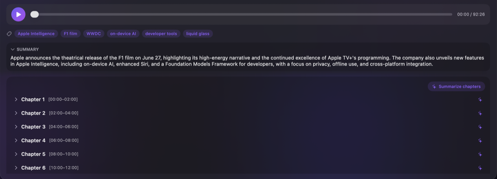
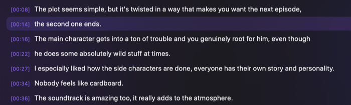
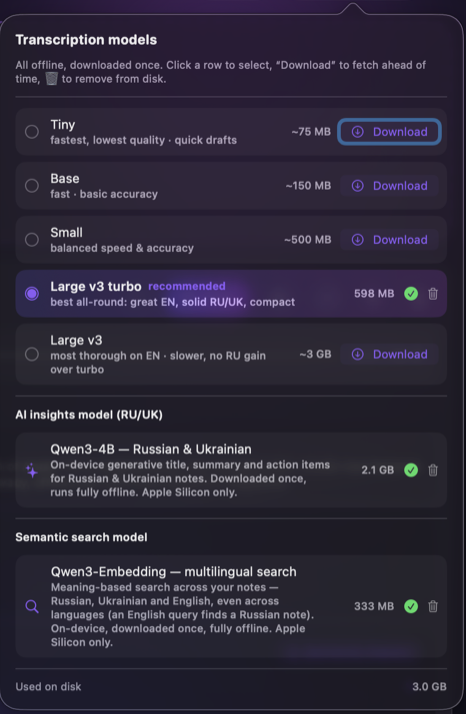
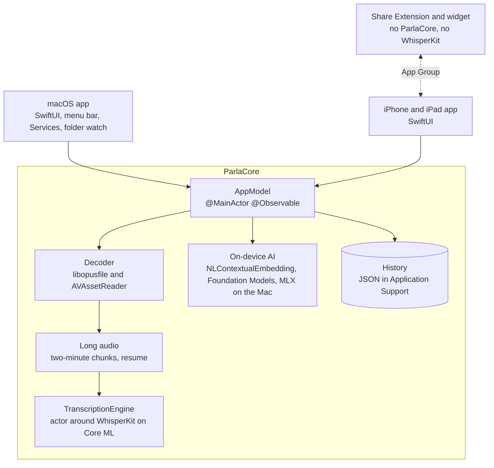

<div align="center">

  

  <h1>Parla</h1>

  <p><b>On-device transcription for Mac, iPhone and iPad.</b><br/>
  Turns Telegram voice messages, audio and video into text with Whisper. No account, no uploads.</p>

  <p>
    <a href="https://github.com/OleksandrUskov/Parla/actions/workflows/ci.yml"></a>
    
    
    
    
  </p>

  <p>
    <a href="#highlights">Highlights</a> |
    <a href="#screenshots">Screenshots</a> |
    <a href="#architecture">Architecture</a> |
    <a href="#build-and-run">Build and run</a> |
    <a href="#author">Author</a>
  </p>

</div>

Parla is my solo project, started in June 2026. The code is one shared Swift library, ParlaCore, with two SwiftUI apps on top: one for the Mac and one for iPhone and iPad. ParlaCore holds more than 60 percent of the production code, including the Whisper engine, audio decoding, long-audio processing, the on-device AI layer and the view model.

**Status, November 2026:** in active development, with an App Store release in preparation. The code in this repository is a public snapshot from 25 August 2026.

<p align="center">
  <br/>
  <sub>On the Mac: a 92-minute keynote split into two-minute chapters, with a generated summary and keywords.</sub>
</p>

## Highlights

- **Telegram audio without ffmpeg.** The v1.0.0 release decoded Ogg/Opus by running a bundled 2.8 MB ffmpeg binary. The main branch decodes in process instead: Ogg/Opus through libopusfile, video and other containers through AVAssetReader, in one decoder that both apps share. That removed the app's only subprocess, and the Mac App Store target builds with the App Sandbox enabled. Telegram often saves voice messages without an extension, so a file with no extension is recognized by its Ogg header.
- **Long recordings that survive interruptions.** Files longer than about ten minutes are cut into two-minute chunks. Each finished chunk is saved, a chunk that fails leaves a marked gap instead of failing the whole file, and a second run of the same file with the same settings skips the chunks already done. On iPhone and iPad, when you leave the app mid-job, it asks iOS for a short grace period so the chunk in flight can finish and be saved.
- **Swift 6 on every target.** The library, both apps and both iOS extensions compile in Swift 6 language mode, and CI runs the macOS test suite a second time under ThreadSanitizer. Swift 6 also checks isolation at run time: a microphone tap closure written inside a `@MainActor` class would trap when AVFAudio calls it on the audio thread, so the tap is installed from a nonisolated function. The transcription engine is an actor that owns the loaded Whisper model and reuses it across files. It joins a load of the same model that is already running and makes a load of another model wait, so two loads never overlap.
- **Lean iOS extensions.** The Share Extension and the widget extension do not link ParlaCore or WhisperKit, so neither of them loads the speech model. The Share Extension copies a shared file into the App Group container under a temporary name and renames it when the copy is complete, so the app never picks up half a file.
- **A check for the wrong language.** On a Russian test file, pinning Ukrainian raised the word error rate from 5.57% to 49.85%. When a language is pinned, the app also runs Whisper's language detection and offers to switch if it hears another language with at least 85% confidence.
- **StoreKit 2, tested.** The store version has a one-time Pro upgrade. Only verified, unrevoked transactions unlock it, and StoreKitTest tests cover a purchase that arrives through `Transaction.updates`, a restore on a fresh install and a refund that removes Pro. The free tier's five-minute cap and Pro-only export formats live in a small type with no StoreKit or UI code. A plain `./build_app.sh` build has none of the free-tier limits.
- **Tested in CI.** The workflow runs 560+ pure-logic unit tests with `swift test`, and the iOS test target runs on a simulator. A committed 6.7 KB synthetic Ogg/Opus file exercises the real decoder in every run. There are six jobs: the tests on macOS 26, the same tests under ThreadSanitizer, a build on the macOS 15 runner, the iOS tests, and two jobs that build the store versions of the Mac app and inspect the bundles.

Start reading here:

- [`Package.swift`](Package.swift): the targets, and MLX limited to macOS.
- [`OpusAudioDecoder.swift`](Sources/ParlaCore/OpusAudioDecoder.swift#L268-L392): the two in-process decoding lanes.
- [`ChunkResume.swift`](Sources/ParlaCore/ChunkResume.swift#L36-L131): how a long job is recognized and resumed.
- [`MicRecorder.swift`](Sources/ParlaCore/MicRecorder.swift#L224-L235): the nonisolated microphone tap that avoids a Swift 6 isolation trap on the audio thread.
- [`BackgroundGrace.swift`](apps/ios/Sources/BackgroundGrace.swift): the SwiftUI modifier that asks iOS for a grace period while a job is running in the background.

## Screenshots

<p align="center">
  <br/>
  <sub>A one-minute recording: the line being played is highlighted, and clicking a timestamp jumps to it. The iPhone and iPad app uses the same ParlaCore view.</sub>
</p>

<p align="center">
  <br/>
  <sub>The model manager: Whisper models from Tiny to Large v3 and the optional AI models, each with its size.</sub>
</p>

## What it does

- Transcribes Telegram voice messages (.ogg, .oga and .opus, or no extension at all), common audio formats (.m4a, .mp3, .wav, .aac, .flac, .amr, .aiff and .caf) and the audio track of .mp4, .mov, .m4v and .3gp videos.
- Detects the spoken language automatically, or uses the one you pick.
- Shows long recordings as chapters with a built-in player. Clicking a timestamp jumps to that moment.
- Lets you correct a transcript in place, re-transcribe it with another Whisper model and search the history.
- Exports a transcript as SRT, VTT, JSON, TXT or Markdown.
- Adds titles, keywords and summaries on the device, and ranks related notes by meaning. On the Mac, generative summaries use Apple Foundation Models on macOS 26, or an optional Qwen3-4B model on MLX for Russian and Ukrainian.
- On the Mac: a menu bar item, a rebindable global hotkey that needs no Accessibility permission, dictation, folder watching, a Finder Services entry, a `parla://` URL scheme and three App Intents for Shortcuts, Spotlight and Siri.
- On iPhone and iPad: dictation, a Share Extension, a Live Activity with transcription progress, a Home Screen widget and two App Intents for Shortcuts and Siri, plus a two-column layout with drag and drop on iPad.
- The interface is in English, Russian and Ukrainian.

## Architecture



- Platform-specific behavior is injected through two factories, `AppModel.mac()` and `AppModel.iOS()`. The two app layers contain four `#if os` lines between them, and each one wraps a whole platform-only file.
- History is one JSON file. Every new field is optional, and a test decodes an old file to keep it that way. If the file is damaged, the app keeps every record it can still read and moves the original aside instead of overwriting it.
- The AI layer never touches the transcript: if a summary or an embedding fails, the text stays as it was.

## Build and run

You need a Mac with Xcode 16.3 or later. The app runs on macOS 14 or later on Apple silicon. Xcode 26 also compiles the Apple Foundation Models backend; with an older SDK, its `#if canImport(FoundationModels)` blocks compile out.

```bash
git clone https://github.com/OleksandrUskov/Parla.git
cd Parla
./build_app.sh    # builds Parla.app; the first build compiles WhisperKit and its dependencies
open Parla.app
```

Open the built `Parla.app` rather than running the package from Xcode: the app needs its bundle, Info.plist and resources. In the app, pick a Whisper model. The recommended one is about 600 MB, downloads once from Hugging Face, and is compiled for the Neural Engine the first time it loads, which takes several minutes. `./build_app.sh --store` builds the store version with the free-tier limits.

For iPhone and iPad:

```bash
cd apps/ios
brew install xcodegen
xcodegen generate
mkdir -p Parla-iOS.xcodeproj/project.xcworkspace/xcshareddata/swiftpm
cp Package.resolved Parla-iOS.xcodeproj/project.xcworkspace/xcshareddata/swiftpm/Package.resolved
open Parla-iOS.xcodeproj
```

For a device build, add your `DEVELOPMENT_TEAM` and replace the `com.parla` bundle IDs and the `group.com.parla.ios` App Group in `apps/ios/project.yml`, then run `xcodegen generate` and copy `Package.resolved` again. The App Group ID is also set in `ShareInbox.swift`, `WidgetSnapshot.swift` and `ShareViewController.swift`. The iOS target builds as the store version; remove `ParlaStoreBuild` from `Parla-iOS-Info.plist` for the full app. Transcription needs a physical device, because WhisperKit's Core ML text decoder does not run in the iOS Simulator.

```bash
swift test    # the macOS unit tests
```

## Privacy

Parla has no upload path: it never sends audio or transcripts to a server, and it has no account, analytics or telemetry. Apart from StoreKit in the store version, which talks to Apple to load products and handle purchases, the network is used only for downloads. From Hugging Face, the app fetches the list of available models when it starts, the Whisper model you choose, and the optional AI models if you turn them on. Apple's NaturalLanguage framework may download its on-device embedding assets from Apple the first time they are needed. The microphone is used only for dictation. The iOS app has a Privacy Manifest that declares no tracking, no data collection and two required-reason APIs: UserDefaults and file timestamps.

## Project layout

```
Sources/ParlaCore/        shared library: engine, decoding, long audio, AI layer, view model
Sources/Parla/            macOS app: SwiftUI, menu bar, Services, folder watch
Sources/ParlaStreamEval/  development tool for word error rate measurements (not shipped)
Sources/ParlaSmoke/       development tool: headless engine smoke run (not shipped)
apps/ios/                 iPhone and iPad app (XcodeGen), Share Extension and widgets
apps/mac/                 Mac App Store target built from the same core
Tests/ParlaTests/         unit tests that CI runs
Localization/             English, Russian and Ukrainian strings shared by both apps
build_app.sh              builds Parla.app
```

## License

The v1.0.0 release is under the MIT License. Later code, including the main branch, is under the [PolyForm Noncommercial License 1.0.0](LICENSE): free for noncommercial use, with commercial rights reserved. It is a source-available license, not an OSI-approved open-source license. Bundled third-party components keep their own licenses, listed in [THIRD_PARTY_NOTICES.md](THIRD_PARTY_NOTICES.md).

## Author

**Oleksandr Uskov**, iOS engineer in Warsaw, MSc Computer Science student

- Email: oleksandruskov.it@gmail.com
- Telegram: [@Alexus27](https://t.me/Alexus27)
- LinkedIn: [oleksandr-uskov](https://www.linkedin.com/in/oleksandr-uskov/)
