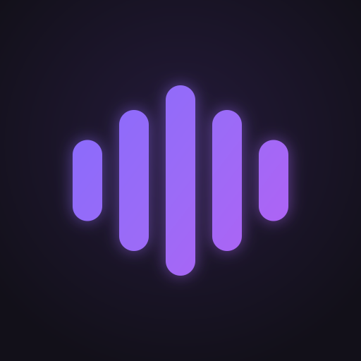
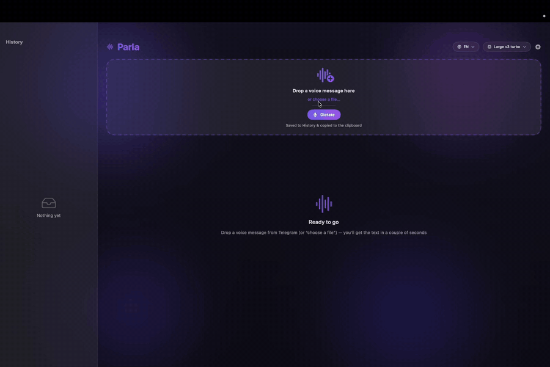
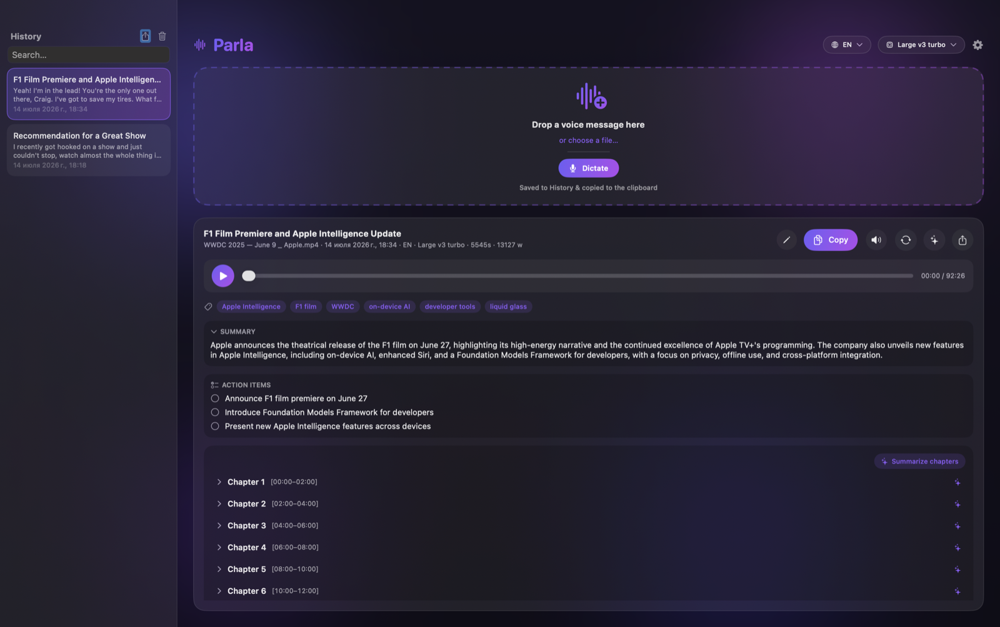
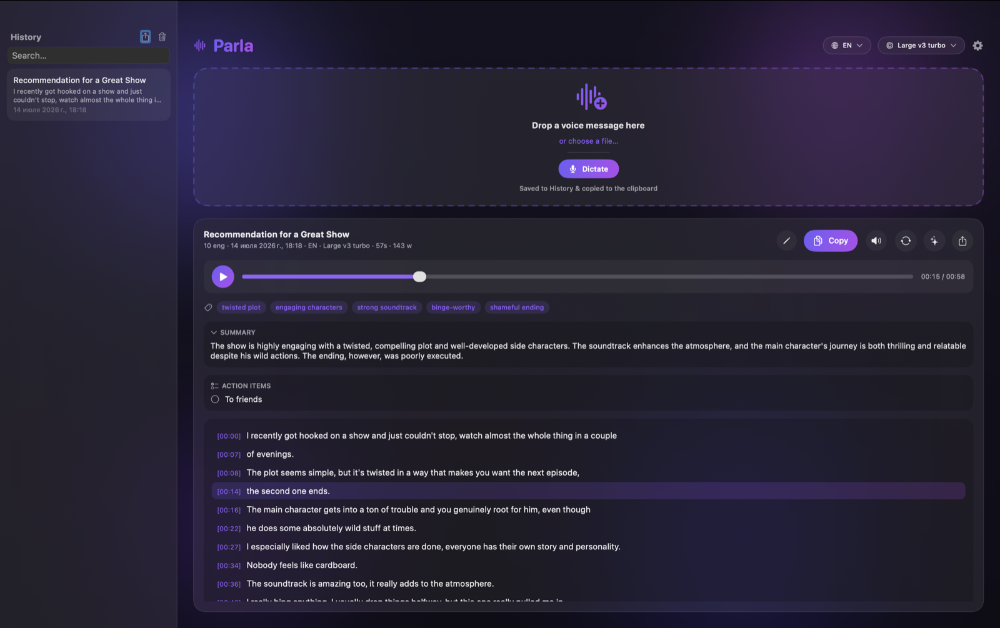
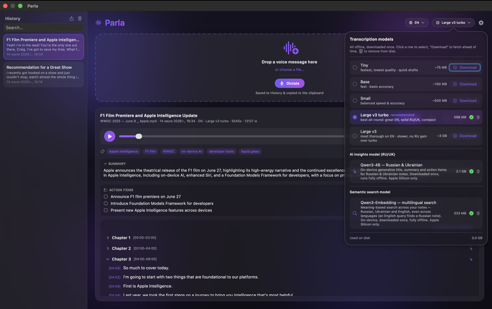
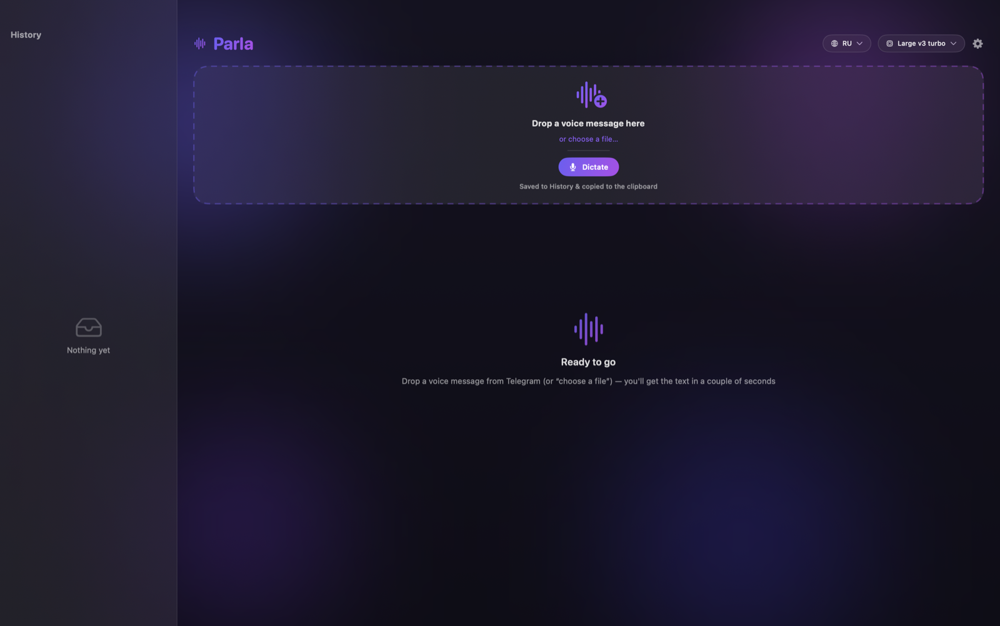
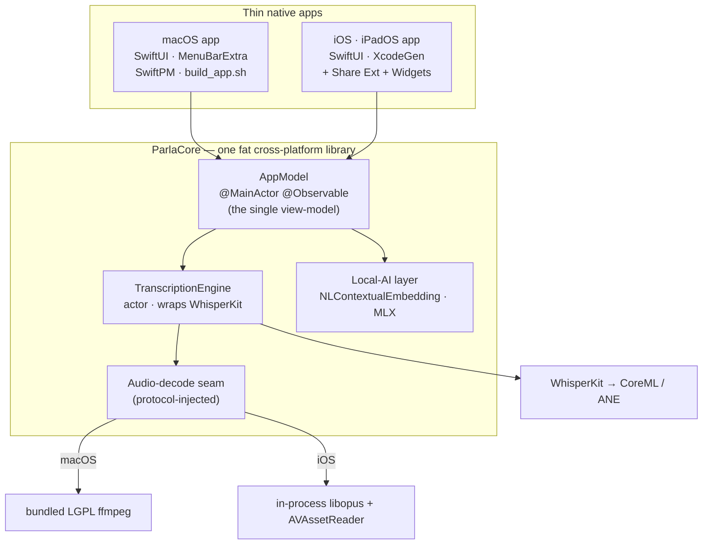

<p align="center">
  
</p>

<h1 align="center">Parla</h1>

<p align="center">
  <strong>Transcribe voice messages to text — 100% on-device.</strong><br>
  A native SwiftUI app for macOS, iPhone &amp; iPad. Drop a Telegram voice note (or any audio/video),
  get clean, copy-ready text in seconds. Nothing ever leaves your device.
</p>

<p align="center">
  <a href="https://github.com/OleksandrUskov/Parla/actions/workflows/ci.yml"></a>
  
  
  
  
  
</p>

<p align="center">
  Powered by <a href="https://github.com/argmaxinc/WhisperKit">WhisperKit</a> running OpenAI Whisper on the
  Apple Neural Engine — no account, no cloud, no telemetry.
</p>

---

<p align="center">
  
</p>

Parla started as a tiny "drag a Telegram `.ogg`, get text" Mac utility and grew into a two-platform,
single-codebase transcription app. One fat cross-platform Swift library (**ParlaCore**) holds all the
logic — the actor-based Whisper engine, the audio-decode seams, the on-device AI layer, the whole
view-model — and thin native apps sit on top of it: a SwiftUI Mac app and a SwiftUI iPhone/iPad app
with a Share Extension, Live Activity, Home-screen widgets, and Handoff.

## Platforms

| | macOS | iOS · iPadOS |
|---|---|---|
| **Minimum** | macOS 14 (Sonoma) | iOS / iPadOS 17 |
| **Get it** | `./build_app.sh` → `Parla.app` | build from source |
| **Audio decode** | bundled LGPL **ffmpeg** (Ogg/Opus + video) | **in-process libopus** xcframework + AVAssetReader — no subprocess |
| **OS integration** | Menu-bar companion · Services menu · `parla://` · Shortcuts/Spotlight/Siri · global hotkey · mic dictation | Share Extension (Telegram → Parla) · **Live Activity / Dynamic Island** · Home widgets · **Handoff** ↔ Mac · `parla://` · Shortcuts/Siri · mic dictation |
| **iPad** | — | first-class: `NavigationSplitView`, drag & drop, ⌘I |

The engine and features are shared, so both apps transcribe with the same accuracy and the same 100%
on-device guarantee.

## Features

**Transcription core**
- 🎙 **Drag & drop** any audio/video — `.ogg` (Telegram), `.m4a`, `.mp3`, `.wav`, `.mp4`, … (or pick a file / whole folder / share sheet on iOS)
- 🧠 **On-device Whisper** via CoreML / Neural Engine — fast, free, private
- 🌍 **~99 languages** with auto-detect — English and any other work out of the box; strong Russian / Ukrainian / surzhik
- 🔁 **Translate to English** — speech in any language straight into English text (Whisper translate task)
- 📖 **Long recordings** — files over ~10 min are chunked (bounded memory, per-chunk progress, resilient to a bad chunk) and shown as collapsible chapters

**Working with transcripts**
- ✏️ **Edit in place** — fix a misheard word; the correction is saved to history
- ▶️ **Built-in player** — listen alongside the text and **click any timestamp to jump** there
- 🔂 **Re-transcribe** an old entry with a different model — compare Tiny vs large-v3 turbo, no re-dragging
- 🔎 **Searchable history** + 🔗 **semantic "Related"** — find past notes by meaning, on-device
- 📤 **Export** each transcript to **SRT / VTT / JSON / TXT / Markdown**, or the whole history to one backup
- 🧩 **Model manager** — pick / download / **delete** models with progress, on-disk size, and a recommended default

**On-device AI layer** *(no cloud)*
- 🏷 **Auto title · summary · keywords** — extractive, computed locally with `NLContextualEmbedding` (great on RU/UK)
- 💬 **Generative summaries & per-chapter recaps** on macOS via Apple **FoundationModels** (English) / **MLX + Qwen** (RU/UK, opt-in download)

**macOS extras**
- ⌨️ **Quick-transcribe from the menu bar** — clipboard, repeat-last, popover drop, or an optional **rebindable** global hotkey (default ⌃⌥⌘T, no Accessibility permission)
- 🎙️ **Live mic dictation** *(opt-in)* — hotkey → speak → hotkey; transcribed on-device and copied
- 👁 **Folder watch** — point Parla at a folder; new audio is transcribed automatically
- 🤖 **Automation** — `parla://` URL scheme, Finder **Services**, **Shortcuts / Spotlight / Siri**

**iOS · iPadOS extras**
- 📲 **Share Extension** — share a Telegram voice note (or any media) straight into Parla
- 🏝 **Live Activity + Dynamic Island** — watch a transcription progress from the lock screen
- 🔲 **Home-screen widgets** — your latest transcripts, one tap to open (deep-linked)
- 🤝 **Handoff** — start reading a transcript on iPhone, continue on the Mac (and back)
- 🗂 **First-class iPad** — two-column layout, Files drag & drop, ⌘I to import

## Screenshots

<table>
<tr>
<td width="50%" valign="top">

<br><sub><b>Long recordings → chapters + AI.</b> A 90-minute talk, transcribed on-device and split into navigable chapters — with an auto-generated summary, action items, and keywords, plus a built-in player and tap-to-seek timestamps.</sub>
</td>
<td width="50%" valign="top">

<br><sub><b>A voice message → text in seconds.</b> Drop a Telegram voice note and read it back with the built-in player, a generative summary, and action items — all computed locally.</sub>
</td>
</tr>
<tr>
<td width="50%" valign="top">

<br><sub><b>Fully offline — and you control it.</b> Pick, download, or delete the Whisper model and the on-device AI stack (generative insights + semantic search). Nothing leaves your Mac.</sub>
</td>
<td width="50%" valign="top">

<br><sub><b>One window, one gesture.</b> Drag a Telegram voice note — or any audio/video — onto the drop zone to begin.</sub>
</td>
</tr>
</table>

> Screenshots are from the macOS app (dark theme). The iPhone/iPad app renders the same reading surfaces through the shared **ParlaCore** library.

## Architecture

A single **mono-repo**: one cross-platform library does the work, thin apps render it.



**Engineering highlights**
- **One library, two apps.** All logic lives in `ParlaCore` (`public` API); the apps are thin SwiftUI shells. Platform differences are handled behind **protocol seams** injected by `AppModel.mac()` / `AppModel.iOS()` factories, not `#if os` sprinkled through the UI.
- **Actor-isolated engine.** `TranscriptionEngine` is an `actor` that owns the loaded Whisper model and reuses it across files. The whole package compiles in **Swift 6 language mode** — strict concurrency, data-race-checked.
- **Two decode lanes, one guarantee.** macOS shells out to a bundled, self-contained LGPL `ffmpeg`; iOS decodes Telegram Ogg/Opus **in-process** via an `libopus` xcframework (no subprocess allowed) and video/`.flac` via `AVAssetReader`. Both stream into the same 16 kHz mono sink and the same chunker.
- **Lean app extensions.** The Share Extension and the Widgets extension **do not link ParlaCore or WhisperKit** — they stay inside the tight extension memory budget and talk to the app through an **App Group** container.
- **Best-effort AI.** The on-device AI layer never touches the transcript: if a summary/embedding fails, the text is unaffected. Vectors are mean-centered before cosine and compared only within a script (Cyrillic vs Latin).
- **Tested logic.** 320+ pure-logic unit tests (macOS `swift test`) plus an iOS test target; a legacy-JSON decode test pins the "every new field is Optional" persistence invariant.

## How it works

```
m4a / mp3 / wav ───────────────────────────────▶ WhisperKit (CoreML / ANE) ──▶ text    (AVFoundation, no decode step)
ogg / opus / video ──▶ decode → 16 kHz mono ────▶ WhisperKit ──────────────▶ text    (macOS: ffmpeg · iOS: libopus/AVAssetReader)
```

- Formats AVFoundation can open go **straight to the engine**. Telegram Ogg/Opus (and video) are decoded first — with **zero setup** on either platform.
- Long recordings (> ~10 min) are split into ~2-min chunks and stitched back into one timeline.
- History is a plain JSON file in the app's Application Support container; the audio cache is auto-capped (macOS 500 MB, evicts oldest audio — the **transcript text is always kept**).

## Build & run

### Prerequisites
- **macOS 14 (Sonoma)+**, **Apple Silicon** recommended (the bundled `ffmpeg` is arm64 — see the Intel note below).
- **Xcode 16+** (for the Swift 6 toolchain) and its Command Line Tools.
- **iOS build only:** [XcodeGen](https://github.com/yonaskolb/XcodeGen) — `brew install xcodegen`.
- Internet for the first build (Swift Package dependencies) and the first transcription (one-time model download).

> The **macOS** app needs **no Apple Developer account** — it's ad-hoc signed locally. Only an **iOS device** build needs signing (your own free or paid Apple ID).

### macOS

```bash
git clone https://github.com/OleksandrUskov/Parla.git
cd Parla
./build_app.sh          # builds Parla.app (first build compiles WhisperKit + deps — a few minutes)
open Parla.app          # or double-click; drag into /Applications to keep
```

In the app, pick a model — it **downloads once** (~600 MB CoreML weights from Hugging Face), compiles for the Neural Engine (one-time), then runs fully offline. Drag a Telegram `.ogg` (or any audio/video) onto the drop zone → text.

> **Run it as the built `.app`, not from an IDE.** Parla's Mac app is a Swift Package, not an Xcode project —
> pressing Build & Run launches the bare executable, and a windowed SwiftUI app needs a real `.app` bundle to
> show its window. Always run via `./build_app.sh && open Parla.app`.
>
> **Intel Macs:** the committed `ffmpeg` (which decodes Telegram Ogg/Opus + video) is arm64-only. On Intel,
> rebuild it via `Vendor/ffmpeg/build.sh`, or `brew install ffmpeg` (picked up automatically as a fallback).

### iOS · iPadOS

```bash
cd apps/ios
brew install xcodegen        # once
xcodegen generate            # generates Parla-iOS.xcodeproj (a build artifact) from project.yml
open Parla-iOS.xcodeproj      # build & run on a real device
```

Before a **device** build: in Xcode set your own **Development Team** on each target (*Signing & Capabilities*), and in `apps/ios/project.yml` change the `com.parla.*` bundle IDs and the `group.com.parla.ios` App Group to identifiers you own (they're all centralized there), then re-run `xcodegen generate`.

> Run on a **physical iPhone/iPad** — WhisperKit's CoreML text decoder needs the Neural Engine, which the
> simulator lacks (the sim builds + runs the UI, but can't do inference). `project.yml` is the checked-in
> source of truth; the `.xcodeproj` is regenerated by [XcodeGen](https://github.com/yonaskolb/XcodeGen).

### Tests

```bash
swift test                   # macOS — the pure-logic unit suite (320+)
```

The iOS test target runs from Xcode (⌘U). A few decode/transcription tests need a local voice fixture that is **not** committed (voice never goes in git) — those `XCTSkip` cleanly when it's absent (expected, not a failure).

## Privacy & permissions

Parla is **100% on-device** — audio is transcribed locally by WhisperKit. Nothing is uploaded; there is
no account, telemetry, or analytics. The only network use is the **one-time model download** (CoreML
weights from Hugging Face). The iOS app ships an Apple **Privacy Manifest** that declares exactly this:
no tracking, no data collection, and the single required-reason API it uses (UserDefaults, for your own
preferences).

Everything beyond plain transcription is **opt-in** and asks for the minimum permission:

| Feature | Permission | Notes |
|---|---|---|
| Transcribe · edit · player · history · export | **none** | local files only |
| Menu-bar / share-sheet quick actions | **none** | reads a file only when you pick or drop it |
| Folder watch *(macOS)* | folder access (one prompt) | only **new** files that appear *after* you turn it on |
| Global hotkey *(macOS, off by default)* | **none** | Carbon `RegisterEventHotKey` — no Accessibility, no keystroke logging |
| Live mic dictation *(off by default)* | **Microphone** (+ Accessibility only for optional auto-paste on macOS) | records **only while you dictate**, transcribes on-device — audio never leaves your device |
| Services · `parla://` · Shortcuts / Siri | **none** | transcribe **existing local files only**, read-only |

The Mac app is **not sandboxed** (it shells out to `ffmpeg`) so it ships outside the Mac App Store — and
it's open source, so you can read exactly what it does.

## Automation / integrations

Parla is also a *verb* other tools can call — everything funnels into the same on-device pipeline.

```bash
open "parla://transcribe?path=/Users/me/voice.ogg"     # transcribe a file (repeat path= for several)
open "parla://transcribe?dir=/Users/me/VoiceNotes"     # transcribe a whole folder
open "parla://transcribe-last"                          # re-run the last file
open "parla://clipboard"                                # transcribe the audio file on the clipboard
open "parla://show"                                     # bring Parla forward
```

Only existing audio files/folders are accepted, read-only — a `parla://` link can never move, write, or
delete anything. On macOS there's also a Finder **Services** entry and three **App Intents** (Shortcuts /
Spotlight / Siri): *Transcribe File*, *Transcribe Last File*, and *Get Last Parla Transcript*.

## Tech stack

Swift 6 toolchain (**Swift 6 language mode**, strict concurrency) · SwiftUI · Swift Concurrency (actors) ·
[WhisperKit](https://github.com/argmaxinc/WhisperKit) · CoreML · NaturalLanguage (`NLContextualEmbedding`) ·
[MLX Swift](https://github.com/ml-explore/mlx-swift) · ActivityKit · WidgetKit · AppIntents ·
[XcodeGen](https://github.com/yonaskolb/XcodeGen) · bundled LGPL ffmpeg (macOS) ·
[opus-binary-xcframework](https://github.com/sbooth/opus-binary-xcframework) (iOS) ·
[KeyboardShortcuts](https://github.com/sindresorhus/KeyboardShortcuts) (MIT)

## Project layout

```
Sources/ParlaCore/     cross-platform library — engine, view-model, AI layer, decode seams
Sources/Parla/         macOS app (thin SwiftUI shell + menu-bar + macOS-only integrations)
apps/ios/              iOS · iPadOS app (XcodeGen project) + Share & Widgets extensions
Localization/          en / ru / uk .lproj (shared by both apps)
Vendor/ffmpeg/         bundled LGPL ffmpeg build recipe
build_app.sh           macOS build → Parla.app
```

## Author & license

Built by **Oleksandr Uskov**. Released under the **MIT License** — see [LICENSE](LICENSE).
